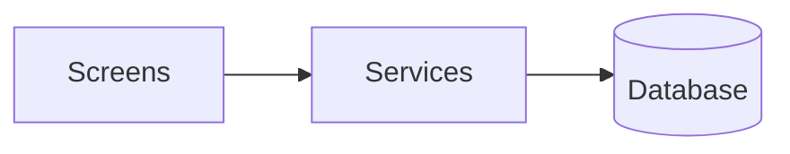

# Architecture — <project>

_The dev-side view: modules and how they connect. This is the ONLY place modules appear — discovery groups by feature, not module. Source of truth._

## Modules

### <Module name>
- **Status:** proposed
- **Type:** INFERENCE | DECISION
- **Source:** existing-system-guide.pdf | AI-inferred
- **Confirmed:**

- **Responsibility:** <what it owns>
- **Features it serves:** <feature ids>
- **Entities it owns:** <ENT- ids>

## System diagram

## Existing system notes

<if there is an existing system: integration points, constraints, what must be preserved>
