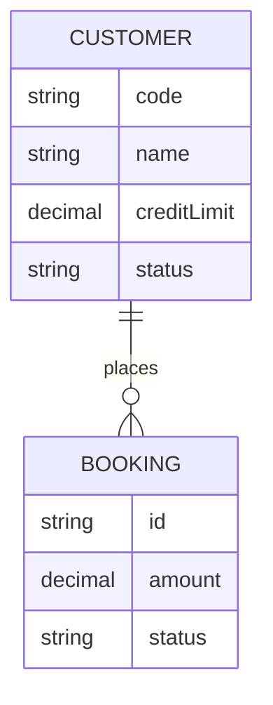

# Entities — <project>

_The shared data model. Every entity gets an `ENT-` id and is referenced by requirements, screens, and db-design. Source of truth._

## Entities

### ENT-001 — <Entity name>
- **Status:** proposed
- **Type:** FACT | INFERENCE
- **Source:** booking.xlsx cols A–E
- **Confirmed:**

- **Fields:** `code` (unique), `name`, `email`, `creditLimit`, `status` [ACTIVE|INACTIVE]
- **Relationships:** has many <ENT-002> (1:N)

## ERD

