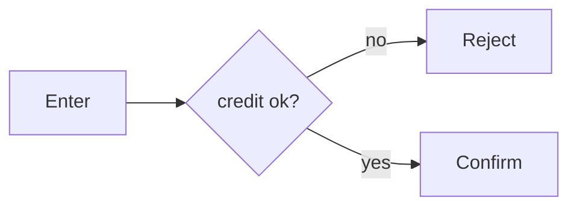

# Flows — <feature>

_Use cases and workflows for this feature. Each `UC-` is an actor's goal; each `FLOW-` is ordered steps + a diagram linking the rules it enforces and the screens it drives. Source of truth._

## Use cases

### UC-001 — <use case title>
- **Status:** proposed
- **Type:** FACT | INFERENCE | DECISION
- **Source:** customer-process.pdf p.5
- **Confirmed:**

- **Actor:** <who>
- **Goal:** <what they want to achieve>
- **Preconditions:** <state before>; <…>
- **Main path:** 1. <step> 2. <step> 3. <step>
- **Requirements:** REQ-001

## Flows

### FLOW-001 — <workflow name>
- **Status:** proposed
- **Type:** FACT | INFERENCE
- **Source:** customer-process.pdf p.5
- **Confirmed:**

- **Trigger:** <what starts it>
- **Steps:**
  1. <actor does X>
  2. validate <rule> (BR-002)
  3. <branch / decision>
  4. <outcome>
- **Rules:** BR-002
- **Screens:** SCR-001

